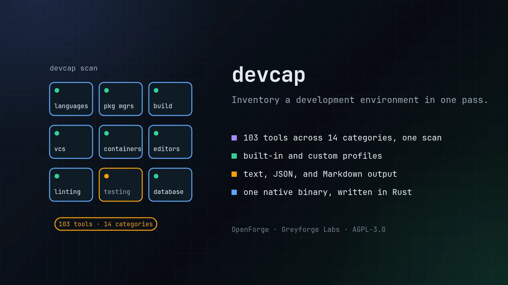

# devcap

> Scan your development environment for installed tools, versions, and capabilities.

**Maintenance status (September 2026):** This standalone scanner is retained for existing users, but Greyforge no longer promotes it as an operator utility or expands its general tool registry. For a new project, declare required tools and versions in that project's setup and CI checks. `devcap check` checks presence of profile-required tools; it does not enforce version constraints. Existing releases and documentation remain available.

[](https://github.com/GreyforgeLabs/devcap/actions/workflows/ci.yml)
[](https://github.com/GreyforgeLabs/devcap/releases/latest)
[](LICENSE)
[](https://www.rust-lang.org)

<p align="center">
  
</p>

## Why This Exists

Setting up a new machine or debugging a CI pipeline means answering: "What's installed? What version? What's missing?" Existing tools like `envinfo` only cover the JS ecosystem. `devcap` scans **103 tools across 14 categories** — languages, package managers, build tools, containers, editors, linters, databases, and more — with structured output you can actually parse.

## Install

Linux x86_64, prebuilt (no Rust toolchain needed):

```bash
VER=v0.3.2
PKG=devcap-$VER-x86_64-unknown-linux-gnu
curl -fsSLO https://github.com/GreyforgeLabs/devcap/releases/download/$VER/$PKG.tar.gz
curl -fsSLO https://github.com/GreyforgeLabs/devcap/releases/download/$VER/$PKG.tar.gz.sha256
sha256sum -c $PKG.tar.gz.sha256
tar xzf $PKG.tar.gz
install -Dm755 $PKG/devcap ~/.local/bin/devcap
devcap scan
```

If the shell answers `devcap: command not found`, add `~/.local/bin` to your `PATH`.

From source, with Rust 1.88 or newer:

```bash
cargo install --locked --git https://github.com/GreyforgeLabs/devcap --tag v0.3.2
```

From a checkout, `./scripts/setup.sh` builds `target/release/devcap` and runs `devcap list-profiles` as a check.

Version 0.3.0 is a faithful Rust rewrite of the 0.2.x Python tool. The commands, flags, profiles, and output formats are unchanged. See [CHANGELOG.md](CHANGELOG.md) for the few intentional differences and [docs/benchmarks.md](docs/benchmarks.md) for measured startup, memory, and footprint numbers.

## Usage

```bash
# Full scan, text output
devcap scan

# JSON output (pipe to jq, store as artifact)
devcap scan --format json

# Markdown tables (paste into docs)
devcap scan --format markdown

# Public-safe metadata: suppress hostname and executable paths
devcap scan --format markdown --redact

# Scan only Python-related tools
devcap scan --profile python-dev

# CI gate: exit 1 if required tools are missing
devcap check --profile devops

# Custom profile
devcap scan --config my-tools.toml

# Explicit bounded probe/profile controls
devcap scan --timeout 3 --max-depth 8 --max-workers 8

# Include project-local/vendor PATH entries such as node_modules/.bin or .venv/bin
devcap scan --profile node-dev --include-vendored

# List available profiles
devcap list-profiles
```

## Built-in Profiles

| Profile | Description | Tools |
|---------|-------------|-------|
| `full` | Everything — all 103 tools | 103 |
| `python-dev` | Python development environment | 12 |
| `node-dev` | Node.js / JavaScript development | 13 |
| `rust-dev` | Rust development environment | 11 |
| `devops` | DevOps and infrastructure | 20 |
| `sysadmin` | Linux system administration | 22 |

## Custom Profiles

Create a TOML file:

```toml
[profile]
name = "my-stack"
description = "My project requirements"

[services]
system = ["docker", "sshd"]

[[tools]]
name = "python3"
category = "Languages"
required = true

[[tools]]
name = "docker"
category = "Containers"
required = true

[[tools]]
name = "my-custom-tool"
binary = "mct"
category = "Custom"
version_flag = "-v"
```

Tools listed in the registry inherit their detection config automatically. Custom tools need `binary` and optionally `version_flag`.

Custom profiles execute local binaries to collect versions. Treat profiles from third-party repositories like code, not passive data. By default, `devcap` rejects unknown keys, duplicate case-normalized tool names, interpreter-style custom commands, vendored/project-local PATH entries such as `node_modules`, `.venv`, `venv`, `__pypackages__`, `.tox`, and `.nox`, and relative PATH entries (`.`, an empty entry such as a trailing `:`, or `bin`), which resolve inside whatever directory devcap runs from; use `--include-vendored` only when you trust the checkout being scanned. Profile reads are capped at 1 MB and parsed from the exact opened file handle.

Version probes cannot read your terminal: stdin is `/dev/null`. They get `LANG=C`, a minimal `PATH`, and only non-secret locator variables such as `HOME`, the XDG base directories, and version-manager roots, so mise, asdf, pyenv, rbenv, nodenv, Volta, and rustup shims report the toolchain your shell would run. See [SECURITY.md](SECURITY.md) for the full list.

## Output Formats

**Text** (default) — columnar, human-readable:
```
=== Languages ===
  python3          3.12.3               /usr/bin/python3
  node             24.12.0              /opt/node/v24.12.0/bin/node
  Missing:
    ruby
```

**JSON** — structured, machine-parseable:
```json
{
  "hostname": "dev-machine",
  "timestamp": "2026-01-01T00:00:00+00:00",
  "platform": "Linux 6.0.0",
  "tools": [{
    "name": "python3",
    "found": true,
    "version": "3.12.3",
    "path": "/usr/bin/python3",
    "version_diagnostics": {
      "source_stream": "stdout",
      "raw_banner": "Python 3.12.3\n",
      "truncated": false
    }
  }],
  "services": [{"name": "docker", "active": true}]
}
```

**Markdown** — tables for documentation or READMEs. Terminal control sequences and Markdown table delimiters from tool output are sanitized before display, but environment inventory can still reveal hostnames, paths, installed tools, and service status. JSON includes the bounded source stream/banner used for version detection. Use `--redact` to replace the hostname, executable paths, raw version banners, and any path inside a version string (a failing probe reports its first error line as the version) before publishing output.

## Exit Codes

| Code | Meaning |
|------|---------|
| 0 | Success (scan) or all required tools present (check) |
| 1 | Missing required tools (check mode only) |
| 2 | Usage error (bad profile name, invalid args) |

## Requirements

- Linux or another Unix-like system (service checks use `systemctl` on Linux)
- Building from source: Rust 1.88+ (`cargo`)
- No runtime dependencies: the binary embeds the built-in profiles and needs no interpreter

## Documentation

- [STARTHERE.md](STARTHERE.md) — AI coding client bootstrap
- [CONTRIBUTING.md](CONTRIBUTING.md) — How to contribute
- [CHANGELOG.md](CHANGELOG.md) — Version history
- [docs/benchmarks.md](docs/benchmarks.md) — Python vs Rust performance measurements

## License

AGPL-3.0. See [LICENSE](LICENSE) for details.

---

<p align="center"><a href="https://greyforge.tech/open-source">More OpenForge tools at greyforge.tech</a></p>

<p align="center"><sub>Background: the <a href="https://greyforge.tech/chronicles/devcap-scanning-your-dev-environment">devcap Chronicle</a> · <a href="https://greyforge.tech/llms.txt">Greyforge llms.txt</a></sub></p>
